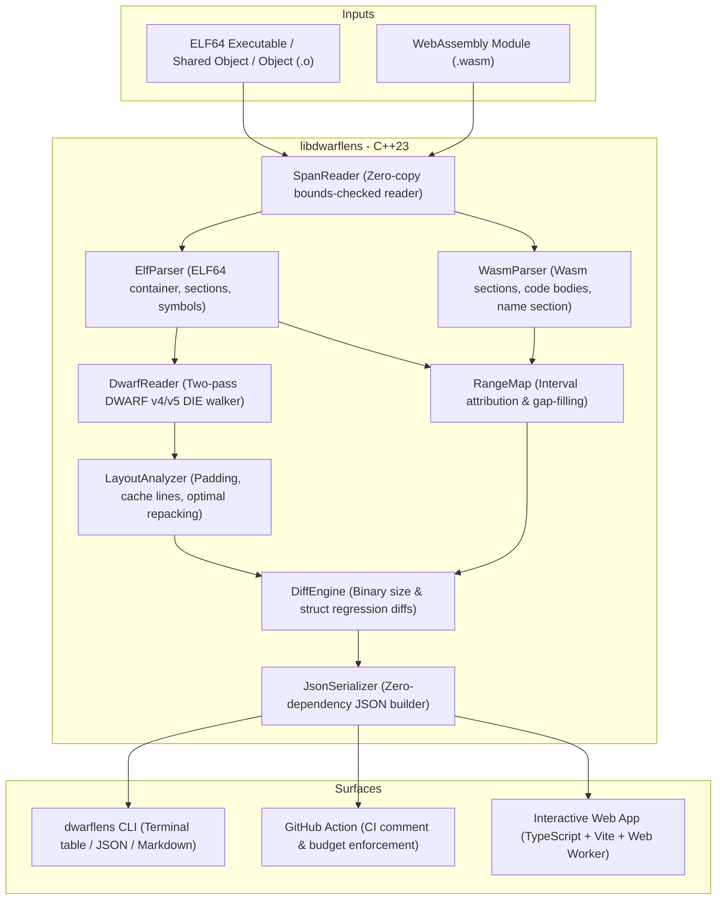

# 🔍 DwarfLens

> **Production-grade visual binary size & DWARF struct memory-layout analyzer for C, C++, Rust, and WebAssembly developers.**

[](https://github.com/dwarflens/dwarflens/actions)
[](LICENSE)
[](CMakeLists.txt)
[](wasm/)

---

## 💡 Overview & Value Proposition

Systems, game, embedded, and WebAssembly developers frequently struggle with binary bloat, mysterious cache misses, and memory overhead. **DwarfLens** answers four critical questions:

1. **Why did my binary grow between builds?**  
   Attributes every byte of an ELF or WebAssembly container to sections, compile units, and demangled symbols. Computes exact deltas between a base build and a target build.
2. **Which symbols and templates drive bloat?**  
   Demangles C++ (`abi::__cxa_demangle`) and Rust symbols, grouping template instantiations (`std::vector<T>` → `std::vector<...>`) to spot monomorphization bloat instantly.
3. **How do my structs and classes actually sit in memory?**  
   Parses DWARF v4 and v5 debug information (`.debug_info`, `.debug_abbrev`, `.debug_str`) to extract compiler-emitted struct layouts, field offsets, alignments, and internal/tail padding holes.
4. **Where are the cache-line splits and how can I fix them?**  
   Detects members straddling 64-byte CPU cache-line boundaries ($\lfloor \text{offset}/64 \rfloor \neq \lfloor (\text{offset}+\text{size}-1)/64 \rfloor$), calculates wasted padding bytes, and computes optimal alignment-preserving field reorderings with copy-pasteable C++ and Rust code snippets.

---

## 🏛️ System Architecture



---

## ⚡ Quickstart

### 1. Build Native CLI and Tests

```bash
# Configure and build
cmake -S . -B build -DCMAKE_BUILD_TYPE=RelWithDebInfo
cmake --build build -j$(nproc)

# Run full test suite (SpanReader, RangeMap, and DWARF extraction)
cd build && ctest --output-on-failure -V
```

### 2. Analyze a Binary

```bash
# Terminal table view
./build/dwarflens analyze ./build/tests/fixtures/sample_target

# JSON format
./build/dwarflens analyze ./build/tests/fixtures/sample_target --format=json

# Markdown format
./build/dwarflens analyze ./build/tests/fixtures/sample_target --format=markdown
```

### 3. Diff Two Binaries (CI Budget Enforcement)

```bash
# Compare base binary vs target binary
./build/dwarflens diff ./build/tests/fixtures/sample_target \
                      ./build/tests/fixtures/sample_target_bloat \
                      --format=table

# Fail if growth exceeds 500 bytes or if struct padding regressed
./build/dwarflens diff base.elf head.elf \
                      --max-growth-bytes=500 \
                      --fail-on-padding-regression
```

---

## 📊 Real Benchmark Output

Executed against test fixture `sample_target` (base) and `sample_target_bloat` (target):

### `dwarflens analyze` Output

```text
🔍 DwarfLens Analysis: tests/fixtures/sample_target
   Format: ELF   File size: 20.4 KiB   Flash: 1.5 KiB   RAM: 112 B

----------------------------------------------------------------------------------------
Section                                                             Size    Category
----------------------------------------------------------------------------------------
.text                                                              890 B        code
.rodata                                                             36 B      rodata
.eh_frame                                                          332 B      rodata
.data                                                               16 B        data
.bss                                                                 8 B         bss
.debug_info                                                      1.8 KiB       debug
.debug_abbrev                                                      352 B       debug
.debug_line                                                        454 B       debug
.symtab                                                            984 B    metadata
----------------------------------------------------------------------------------------

📊 Top Symbols by Size:
----------------------------------------------------------------------------------------
Symbol                                                              Size        Type
----------------------------------------------------------------------------------------
main                                                               466 B        func
compute_product(double, int)                                        85 B        func
compute_sum(int)                                                    50 B        func
float identity<float>(float)                                        20 B        func
double identity<double>(double)                                     20 B        func
int identity<int>(int)                                              16 B        func
----------------------------------------------------------------------------------------

🏗️  DWARF Struct Layouts:

  struct BadLayout { size=24B, padding=10B, cache_lines=1 }
    +   0  char                           a
    +   8  double                         b
    +  16  char                           c
    +  20  int                            d
    💡 Reorder saves 8 bytes (24B -> 16B)

  struct CrossingStruct { size=72B, padding=0B, cache_lines=2 } ⚠️ cache-line split!
    +   0  uint8_t[60]                    header
    +  60  uint64_t                       crossing_val
    +  68  uint32_t                       trailer

  struct GoodLayout { size=24B, padding=0B, cache_lines=1 }
    +   0  double                         x
    +   8  int64_t                        y
    +  16  int32_t                        z
    +  20  int16_t                        w
    +  22  int8_t                         v
    +  23  int8_t                         u

  struct TailPad { size=16B, padding=7B, cache_lines=1 }
    +   0  int64_t                        big
    +   8  int8_t                         small
```

### `dwarflens diff` Output

```text
🔀 DwarfLens Diff: sample_target → sample_target_bloat

  File size: +344 B (1.64%)
  Flash:     +122 B (7.69%)
  RAM:       +0 B (0.00%)

📦 Section Deltas:
------------------------------------------------------------------------------------------
Section                                                     Base       Delta         %
------------------------------------------------------------------------------------------
.debug_info                                              1.8 KiB     +161 B       +8%
.text                                                      890 B      +82 B       +9%
.debug_line                                                454 B      +46 B      +10%
.debug_str                                                 920 B      +45 B       +4%
.symtab                                                    984 B      +24 B       +2%
------------------------------------------------------------------------------------------

📊 Top Symbol Deltas:
------------------------------------------------------------------------------------------
Symbol                                                      Base       Delta
------------------------------------------------------------------------------------------
extra_function_added_in_target()                             0 B       +51 B
main                                                       466 B       +31 B
------------------------------------------------------------------------------------------
```

---

## 🧠 Struct Memory Layout Optimizer

When `BadLayout` is analyzed:

```cpp
struct BadLayout {
    char   a; // 1 byte
    // 7 bytes padding hole
    double b; // 8 bytes
    char   c; // 1 byte
    // 3 bytes padding hole
    int    d; // 4 bytes
}; // Total: 24 bytes (10 bytes padding, 41.7% wasted)
```

DwarfLens computes the optimal alignment-sorted field order and generates copy-pasteable definitions:

### Optimized C++

```cpp
// Optimal repacked layout: was 24 bytes, now 16 bytes (saves 8 bytes per instance)
struct BadLayout {
    double b; // offset: 0, size: 8
    int d;    // offset: 8, size: 4
    char a;   // offset: 12, size: 1
    char c;   // offset: 13, size: 1
    // tail padding: 2 bytes
};
```

### Optimized Rust

```rust
#[repr(C)]
pub struct BadLayout {
    pub b: f64,
    pub d: i32,
    pub a: i8,
    pub c: i8,
}
```

---

## 🌐 Web Application (TypeScript + Vite)

DwarfLens features a responsive dark-mode web application running 100% locally in the browser. Users can drag and drop ELF or WebAssembly binaries for local analysis, or explore bundled demo datasets.

```bash
cd web
npm install
npm run dev     # Start local Vite dev server
npm run build   # Production bundle to web/dist/ (zero TS errors)
```

### Web Visualizers:
- **Proportional Size Treemap / Bars**: Visual distribution of `.text`, `.rodata`, `.data`, `.bss`, and debug sections.
- **Searchable Symbol Table**: Demangled symbol inspection with template grouping.
- **64-Byte Cache-Line Struct X-Ray**: Interactive 8-byte row grid color-coding struct fields, displaying hatched red padding holes, and marking 64-byte CPU cache boundaries with side-by-side refactor suggestions.
- **Side-by-Side Diff View**: Visual comparison of additions, deletions, and layout regressions.

---

## 🤖 GitHub Action Integration

Add DwarfLens to your PR workflow using `.github/workflows/ci.yml` or the standalone action `action/action.yml`:

```yaml
- name: Run DwarfLens Diff
  uses: dwarflens/dwarflens/action@main
  with:
    base-binary: base_build/my_app
    target-binary: head_build/my_app
    format: markdown
    max-growth-bytes: '10240'       # Fail PR if binary grew by > 10 KiB
    fail-on-padding-regression: true # Fail PR if struct padding increased
```

---

## 🛠️ WebAssembly Compilation (Emscripten)

To compile the C++23 core to `dwarflens.wasm` using Emscripten:

```bash
# Using emcmake
emcmake cmake -S . -B build-wasm -DCMAKE_BUILD_TYPE=Release
cmake --build build-wasm --target dwarflens_wasm
cp build-wasm/dwarflens_wasm.js web/public/
cp build-wasm/dwarflens_wasm.wasm web/public/
```

---

## 📄 License
All Rights Reserved. Copyright (c) 2026 Shubham (shubham-dataeng). Proprietary software — unauthorized copying, modification, or distribution is strictly prohibited.
