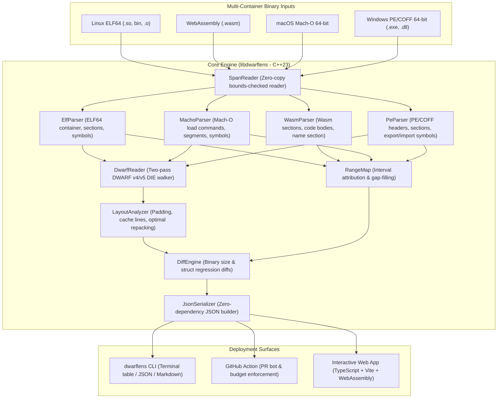

# 🔍 DwarfLens

> **A high-performance systems engineering tool that helps C, C++, Rust, and WebAssembly developers find wasted memory, eliminate CPU cache misses, and prevent binary bloat in CI.**

[](https://shubham-core.github.io/dwarflens/)
[](https://github.com/shubham-core/dwarflens/actions)
[](https://github.com/shubham-core/dwarflens/actions)
[](https://github.com/shubham-core/dwarflens/releases)
[](LICENSE)
[](CMakeLists.txt)
[](wasm/)

---

### 🎯 Non-Technical Summary / The Recruiter Hook
*In software development, memory layout and binary size directly control speed, battery life, and cloud costs. Inefficient data structures introduce invisible "padding holes" that waste megabytes of RAM and trigger severe CPU cache latency penalties. **DwarfLens** is a developer tool that automatically inspects compiled application binaries, visualizes data structures down to individual bytes, alerts engineers to CPU cache-line crossings, and generates optimized code fixes with one click.*

---

## 🥊 DwarfLens vs. Bloaty McBloatface & Pahole

Developers previously had to switch between multiple disjointed command-line tools to diagnose binary footprint and memory layout issues. DwarfLens unites these workflows into a single zero-dependency engine with a client-side WebAssembly GUI and automated CI budget enforcement:

| Capability / Feature | DwarfLens | Bloaty McBloatface (Google) | Pahole (dwarves) |
| :--- | :---: | :---: | :---: |
| **Combined Size & Memory-Layout Analysis** | ✅ **Yes (Unified Engine)** | ❌ Size attribution only | ❌ Struct layout only |
| **Zero-Install WebAssembly UI** | ✅ **Yes (100% Client-Side Wasm)** | ❌ CLI only | ❌ CLI only |
| **Binary Formats Supported** | ✅ **ELF64, WebAssembly, Mach-O, PE/COFF** | ⚠️ ELF, Mach-O (No Wasm / PE) | ⚠️ ELF only |
| **64-Byte CPU Cache-Line Split Detection** | ✅ **Exact boundary alerts & visualizer** | ❌ None | ⚠️ Partial text flags |
| **Optimal Field Repacker with Code Gen** | ✅ **Copy-paste C++ & Rust snippets** | ❌ None | ❌ Manual diagnosis only |
| **Automated CI Budget & PR Regression Checks** | ✅ **Built-in `--max-growth-bytes`** | ⚠️ Custom bash scripts | ❌ None |
| **Zero-Dependency Architecture** | ✅ **C++23 Standard Library only** | ⚠️ Heavy deps (Abseil, re2, capstone) | ⚠️ Linux deps (libdw, elfutils) |
| **Memory-Safety Fuzzing Suite** | ✅ **LLVM libFuzzer + Standalone CI harness** | ⚠️ Basic OSS-Fuzz | ❌ None |

---

## 💡 Overview & Value Proposition

Systems, game, embedded, and WebAssembly engineers answer four critical questions with DwarfLens:

1. **Why did my binary grow between builds?**  
   Attributes every byte of an ELF, WebAssembly, Mach-O, or PE/COFF binary to sections, compile units, and demangled symbols. Computes exact deltas between a base build and a target build.
2. **Which symbols and templates drive bloat?**  
   Demangles C++ (`abi::__cxa_demangle`) and Rust symbols, grouping template instantiations (`std::vector<T>` → `std::vector<...>`) to spot monomorphization bloat instantly.
3. **How do my structs and classes actually sit in memory?**  
   Parses DWARF v4 and v5 debug information (`.debug_info`, `.debug_abbrev`, `.debug_str`) to extract compiler-emitted struct layouts, field offsets, alignments, and internal/tail padding holes.
4. **Where are the cache-line splits and how can I fix them?**  
   Detects members straddling 64-byte CPU cache-line boundaries ($\lfloor \text{offset}/64 \rfloor \neq \lfloor (\text{offset}+\text{size}-1)/64 \rfloor$), calculates wasted padding bytes, and computes optimal alignment-preserving field reorderings with copy-pasteable C++ and Rust code snippets.

---

## 🏛️ System Architecture



---

## 📦 Distribution & Pre-built Binaries

Statically linked, zero-dependency release binaries are automatically compiled and published on every tagged release:

- **Linux x86_64**: `dwarflens-linux-x86_64.tar.gz`
- **macOS Apple Silicon (arm64)**: `dwarflens-macos-arm64.tar.gz`
- **macOS Intel (x86_64)**: `dwarflens-macos-x86_64.tar.gz`
- **Windows x86_64**: `dwarflens-windows-x86_64.zip`

Each release archive includes SHA256 checksums verified by GitHub Actions.

---

## ⚡ Quickstart

### 1. Build Native CLI and Tests

```bash
# Configure and build with native compiler
cmake -S . -B build -DCMAKE_BUILD_TYPE=RelWithDebInfo
cmake --build build -j$(nproc)

# Run full automated test suite (Unit tests + DWARF extraction + Fuzz resilience)
cd build && ctest --output-on-failure -V
```

### 2. Analyze a Binary

```bash
# Formatted terminal table view
./build/dwarflens analyze ./build/tests/fixtures/sample_target

# Structured JSON format (for automation pipelines)
./build/dwarflens analyze ./build/tests/fixtures/sample_target --format=json

# Markdown format (ready for GitHub PR summaries)
./build/dwarflens analyze ./build/tests/fixtures/sample_target --format=markdown
```

### 3. Diff Two Binaries (CI Budget Enforcement)

```bash
# Compare base binary vs target binary
./build/dwarflens diff ./build/tests/fixtures/sample_target \
                      ./build/tests/fixtures/sample_target_bloat \
                      --format=table

# Enforce strict CI size and struct padding budgets:
./build/dwarflens diff base_app target_app \
                      --max-growth-bytes=10240 \
                      --fail-on-padding-regression
```

---

## 🔧 Compiler Flags & DWARF Extraction Context

The quality and completeness of struct layout extraction depends on compiler debug generation settings:

### `-g` vs. `-g1` vs. `-g3`
- **`-g1` (Minimal)**: Emits line numbers for backtraces but completely strips `DW_TAG_structure_type` and `DW_TAG_member` records. DwarfLens accurately calculates container and section footprints, but cannot reconstruct struct memory layouts.
- **`-g` / `-g2` (Recommended)**: Emits full debug records for all data structures and functions utilized in the binary. This is the optimal setting for DwarfLens.
- **`-g3` (Macro Expansion)**: Includes preprocessor macro tables (`.debug_macro` / `.debug_macinfo`). Struct layouts are identical to `-g`, but debug section sizes will be significantly larger.

### GCC vs. Clang Considerations
- **GCC Type Pruning**: GCC enables `-feliminate-unused-debug-types` by default in optimized builds. If a struct is declared in a header but not instantiated or referenced by compiled code, GCC will omit its DIE. To inspect all declared types, compile with:
  ```bash
  g++ -g -O2 -fno-eliminate-unused-debug-types my_app.cpp -o my_app
  ```
- **Clang Standalone Debug**: Clang may emit forward declarations instead of full type definitions if a type is defined in an external compilation unit. Use `-fstandalone-debug` when compiling test fixtures or libraries to force complete layout emission.

---

## ⚡ Link-Time Optimization (LTO) Handling

When Link-Time Optimization (`-flto` or `-fuse-ld=lld / -flto=thin`) is enabled, compilers rewrite and merge whole-program call graphs:

1. **Section Splitting & Inlining**: Functions and symbols may be fragmented across `.text.hot`, `.text.unlikely`, and `.text.startup`. DwarfLens uses interval trees (`RangeMap`) to attribute non-contiguous address ranges accurately without double-counting bytes.
2. **Inter-CU Type References**: In LTO, the linker combines compilation units and references types using `DW_FORM_ref_addr` (cross-CU global offsets) rather than local `DW_FORM_ref4`. DwarfLens's two-pass DWARF DIE walker tracks absolute section offsets to resolve type names and sizes seamlessly across compilation unit boundaries.
3. **Dead-Stripping**: Unused struct members and virtual tables stripped by LTO are properly reflected: DwarfLens only reports layouts for structures that survive code generation into the final binary.

---

## 🛡️ Memory Safety, Fuzz Testing & Browser Protection

Because binary parsers ingest untrusted, potentially hostile inputs, DwarfLens implements defense-in-depth safety:

1. **Zero Raw Pointer Arithmetic**: All reads are guarded by zero-copy `std::span<const uint8_t>` bounds-checked readers (`SpanReader`). Out-of-bounds reads return structured `std::unexpected(ReadError::OutOfBounds)` rather than triggering undefined behavior or memory violations.
2. **Cap on Variable-Length Integers**: ULEB128/SLEB128 decoders are strictly capped at 10 iterations (`ceil(64/7)`) to prevent CPU exhaustion on cyclic or corrupted byte streams.
3. **LLVM libFuzzer & Continuous Fuzzing**: A dedicated fuzz target (`fuzz/fuzz_targets.cpp`) exercises the ELF, WebAssembly, Mach-O, PE, and DWARF parsers against millions of mutated inputs with AddressSanitizer (ASan) and UndefinedBehaviorSanitizer (UBSan).
4. **Browser Memory Protection**: In the Web UI, files over **256 MB** are intercepted with an informative memory shield directing users to the native zero-copy CLI to prevent crashing browser tab WebAssembly linear memory heaps.

---

## 🌐 Web Application (TypeScript + Vite)

DwarfLens features a responsive dark-mode web application running 100% locally in the browser. Users can drag and drop binaries for local analysis, or explore bundled demo datasets.

```bash
cd web
npm install
npm run dev     # Start local Vite dev server
npm run build   # Production bundle to web/dist/ (zero TS errors)
```

### Visualizers:
- **Proportional Size Treemap & Category Bars**: Visual distribution of Code (`.text`), Read-Only Data (`.rodata`), Data (`.data`), BSS, and Debug sections.
- **Demangled Symbol Explorer**: Instant search with template grouping (`Foo<T>`).
- **64-Byte Cache-Line Struct X-Ray**: Interactive 8-byte row grid color-coding struct fields, displaying hatched red padding holes, and marking 64-byte CPU cache boundaries with side-by-side refactor suggestions.
- **Side-by-Side Diff View**: Visual comparison of size regressions and padding deltas.

---

## 🤖 GitHub Action Integration

Add DwarfLens to your PR workflow using `.github/workflows/ci.yml` or the standalone action `action/action.yml`:

```yaml
- name: Run DwarfLens Diff
  uses: shubham-core/dwarflens/action@main
  with:
    base-binary: base_build/my_app
    target-binary: head_build/my_app
    format: markdown
    max-growth-bytes: '10240'        # Fail PR if binary grew by > 10 KiB
    fail-on-padding-regression: true # Fail PR if struct padding increased
```

---

## 📄 License

DwarfLens is released under the **[MIT License](LICENSE)**. Open source and free for commercial and personal use.
