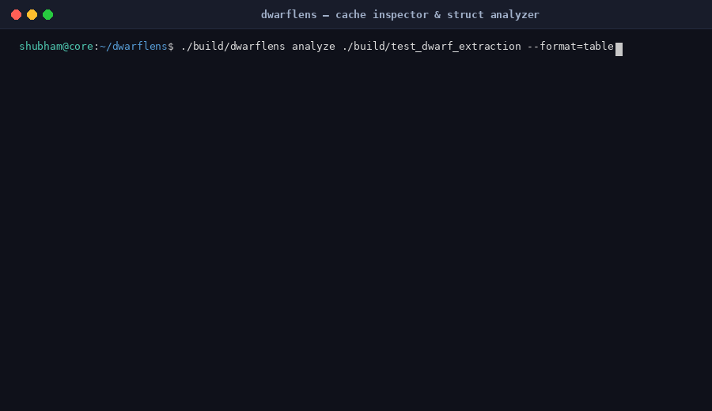

# 🔍 DwarfLens

<p align="center">
  <a href="https://shubham-core.github.io/dwarflens/">
    
  </a>
  <br>
  <em>Live Demo: Zero-dependency C++23 systems profiling engine detecting 64-byte CPU cache-line splits and memory bloat.</em>
</p>

> **A zero-dependency C++23 systems profiling engine that inspects DWARF debug metadata, pinpoints 64-byte CPU cache-line splits, calculates padding holes, and eliminates binary bloat via native CLI and WebAssembly.**

[](https://shubham-core.github.io/dwarflens/)
[](https://dwarflens.onrender.com/health)
[](CMakeLists.txt)
[](wasm/)
[](https://github.com/shubham-core/dwarflens/actions)
[](https://github.com/shubham-core/dwarflens/actions)
[](LICENSE)

---

## ⚡ Quickstart

### 1. Build Native CLI & Run Tests
```bash
cmake -S . -B build -DCMAKE_BUILD_TYPE=Release
cmake --build build -j$(nproc)
ctest --test-dir build --output-on-failure
```

### 2. Inspect a Binary
```bash
# Terminal table view with struct padding & cache line metrics
./build/dwarflens analyze ./my_app

# Machine-readable JSON output
./build/dwarflens analyze ./my_app --format=json

# GitHub PR Markdown output
./build/dwarflens analyze ./my_app --format=markdown
```

### 3. Diff Builds (CI Budget Enforcement)
```bash
# Detect size bloat and padding regressions between base and target commits
./build/dwarflens diff ./base_app ./target_app \
                      --max-growth-bytes=10240 \
                      --fail-on-padding-regression
```

---

## 🥊 DwarfLens vs. Bloaty McBloatface & Pahole

Developers previously had to switch between multiple disjointed command-line utilities to diagnose binary footprint and memory layout issues. DwarfLens unites these workflows into a single zero-dependency engine with a client-side WebAssembly GUI and automated CI budget enforcement:

| Capability / Feature | DwarfLens | Bloaty McBloatface (Google) | Pahole (dwarves) |
| :--- | :---: | :---: | :---: |
| **Combined Size & Memory-Layout Analysis** | ✅ **Yes (Unified Engine)** | ❌ Size attribution only | ❌ Struct layout only |
| **Zero-Install WebAssembly UI** | ✅ **Yes (100% Client-Side Wasm)** | ❌ CLI only | ❌ CLI only |
| **Binary Formats Supported** | ✅ **ELF64, WebAssembly, Mach-O, PE/COFF** | ⚠️ ELF, Mach-O, WebAssembly | ⚠️ ELF, BTF (Linux kernel) |
| **64-Byte CPU Cache-Line Split Detection** | ✅ **Exact boundary alerts & min/max bounds** | ❌ None | ⚠️ Partial text flags |
| **Size-Optimal Struct Repacker** | ✅ **Alignment reordering with ABI safety warnings** | ❌ None | ❌ Manual diagnosis only |
| **Automated CI Budget & PR Regression Checks** | ✅ **Built-in `--max-growth-bytes`** | ⚠️ Custom bash scripts | ❌ None |
| **Zero-Dependency Core** | ✅ **C++23 stdlib only** *(demangling via libc++abi/libsupc++)* | ⚠️ Heavy deps (Abseil, re2, capstone) | ⚠️ Linux deps (libdw, elfutils) |
| **Memory-Safety Fuzzing Suite** | ✅ **LLVM libFuzzer + Standalone CI harness** | ⚠️ Basic OSS-Fuzz | ❌ None |

---

## 💡 What DwarfLens Solves

Systems, game, embedded, and WebAssembly engineers answer four critical questions with DwarfLens:

1. **Why did my binary grow between builds?**  
   Attributes every byte of an ELF, WebAssembly, Mach-O, or PE/COFF binary to sections, compile units, and demangled symbols. Computes exact deltas between a base build and a target build.
2. **Which symbols and templates drive bloat?**  
   Demangles C++ (`abi::__cxa_demangle`) and Rust symbols, grouping template instantiations (`std::vector<T>` → `std::vector<...>`) to spot monomorphization bloat instantly.
3. **How do my structs sit in memory?**  
   Parses DWARF v4 and v5 debug information (`.debug_info`, `.debug_abbrev`, `.debug_str`) to extract compiler-emitted struct layouts, field offsets, alignments, and internal/tail padding holes.
4. **Where are the cache-line splits and how can I fix them?**  
   Detects members straddling 64-byte CPU cache-line boundaries ($\lfloor \text{offset}/64 \rfloor \neq \lfloor (\text{offset}+\text{size}-1)/64 \rfloor$), calculates wasted padding bytes, reports min/max cache lines touched, and proposes size-optimal alignment-preserving field reorderings with copy-pasteable C++ and Rust snippets.

---

## ⚠️ Known Limitations & Engineering Assumptions

DwarfLens is built for speed, transparency, and portability. Please keep these technical realities in mind:

- **Cache-Line Alignment Assumption:** Cache-line straddle calculations assume the struct instance begins at a 64-byte aligned boundary (`0 mod 64`), matching `pahole`. For structs with `alignof < 64`, instances allocated at runtime can straddle cache lines at different offsets. DwarfLens explicitly reports both `min_cache_lines_touched` (aligned) and `max_cache_lines_touched` (worst-case unaligned placement).
- **Size-Optimal vs. Hot/Cold Access:** Sorting fields by descending alignment minimizes padding bytes. It does **not** model runtime cache access frequency (hot/cold field grouping). In performance-critical systems, keeping frequently accessed fields together takes precedence over packing.
- **ABI Stability Warning:** Field reordering alters binary memory layout. **Never** reorder structs that are exposed across public C library ABIs, serialized over networks, memcopied, or memory-mapped.
- **Compressed DWARF (`SHF_COMPRESSED` / `.zdebug`):** Compilers can compress DWARF using `-gz` (zlib/zstd). Because DwarfLens maintains a zero-dependency architecture, it does not bundle decompression libraries. Decompress with `objcopy --decompress-debug-sections` or compile with `-gz=none`.
- **Platform Debug Boundaries:**
  - **macOS (Mach-O):** Container size and symbol attribution are supported. Struct layout extraction requires unstripped binaries, `.o` object files, or `.dSYM` bundles (Apple linkers strip DWARF from final executables).
  - **Windows (PE/COFF):** Full PE container and symbol attribution are supported. DWARF struct layout extraction is supported for GCC/Clang (MinGW-w64). Proprietary MSVC `.pdb` (CodeView) files are not parsed.
- **Browser Memory Ceiling:** The client-side WebAssembly analyzer enforces a 256 MB safety shield to protect 32-bit browser memory heaps. Use the native CLI for larger binaries.

See [docs/LIMITATIONS.md](docs/LIMITATIONS.md) for full technical documentation.

---

## 📦 Distribution & Pre-built Binaries

Statically linked release binaries with SHA256 verification are published on tagged releases:

- **Linux x86_64**: `dwarflens-linux-x86_64.tar.gz`
- **macOS Apple Silicon (arm64)**: `dwarflens-macos-arm64.tar.gz`
- **Windows x86_64**: `dwarflens-windows-x86_64.zip`

---

## 🤖 GitHub Action Integration

Add DwarfLens to your PR workflow using `.github/workflows/ci.yml` or the standalone action `action/action.yml`:

```yaml
- name: Run DwarfLens Diff
  uses: shubham-core/dwarflens/action@main
  with:
    base-binary: base_build/my_app
    target-binary: head_build/my_app
    format: markdown
    max-growth-bytes: '10240'        # Fail PR if binary grew by > 10 KiB
    fail-on-padding-regression: true # Fail PR if struct padding increased
    api-url: 'https://dwarflens.onrender.com'
    api-key: ${{ secrets.DWARFLENS_API_KEY }}
```

---

## ☁️ DwarfLens Cloud (CI/CD SaaS Platform)

DwarfLens Cloud transforms the native profiling engine into an automated team monitoring platform for binary footprint and cache efficiency regressions.

- **Zero-Knowledge Privacy:** Binaries **NEVER** leave your runners. Only schema-validated analysis JSON metadata (`< 5 MB`) is uploaded.
- **Historical Size & Layout Trends:** Interactive SVG trendlines tracking Flash and RAM consumption across branches and commits over time.
- **Automated Sticky PR Comments:** Posts and updates a single concise GitHub PR comment with section size deltas, top bloated symbols, and struct padding changes.
- **Team Alerts (Slack & Email):** Automated notifications to project owners via email and Slack webhooks when budgets fail on `main`.
- **Shareable Public Reports:** Time-limited or revocable public report tokens to share binary layout audits with external teams.
- **Granular RBAC:** Multi-tenant workspaces with `owner`, `member`, and `viewer` permissions.

---

## 📚 Documentation & Guides

- [5-Minute Quickstart Guide](docs/QUICKSTART.md)
- [Architecture & Pipeline Specification](docs/ARCHITECTURE.md)
- [Limitations & Engineering Trade-offs](docs/LIMITATIONS.md)
- [Compiler Flags & LTO Optimization Guide](docs/COMPILER_GUIDE.md)
- [Security Architecture & Vulnerability Policy](docs/SECURITY.md)
- [REST API Reference](docs/API_REFERENCE.md)
- [Analysis JSON Schema Specification](docs/SCHEMA_REFERENCE.md)
- [Multi-Tenant Data Model](docs/DATA_MODEL.md)
- [Deployment & Self-Hosting Guide](docs/DEPLOYMENT.md)
- [Privacy Policy](docs/PRIVACY.md)
- [Terms of Service](docs/TERMS.md)
- [Frequently Asked Questions (FAQ)](docs/FAQ.md)
- [Changelog](CHANGELOG.md)
- [Contributing Guidelines](CONTRIBUTING.md)

---

## 📄 License

DwarfLens is released under the **[MIT License](LICENSE)**. Open source and free for commercial and personal use.
