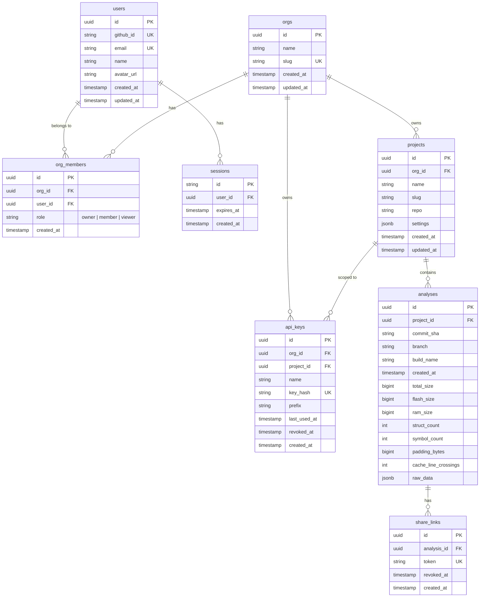

# DwarfLens Data Model

This document outlines the database schema and entity relationships for DwarfLens SaaS.

## Entity-Relationship Diagram

## Tables & Indexes

### 1. `users`
Stores user profile information synced from GitHub OAuth.
- **Primary Key**: `id` (UUIDv4)
- **Unique Constraints**: `github_id`, `email`

### 2. `sessions`
Web session tokens for user authentication stored in secure, `httpOnly`, `sameSite` cookies.
- **Primary Key**: `id` (Cryptographic session token string)
- **Foreign Key**: `user_id` -> `users(id)` ON DELETE CASCADE

### 3. `orgs`
Multi-tenant isolation boundary. Every project and API key belongs to an organization.
- **Primary Key**: `id` (UUIDv4)
- **Unique Constraint**: `slug`

### 4. `org_members`
Association table between users and organizations with role-based access control.
- **Primary Key**: `id` (UUIDv4)
- **Foreign Keys**: `org_id` -> `orgs(id)` ON DELETE CASCADE, `user_id` -> `users(id)` ON DELETE CASCADE
- **Roles**: `'owner'`, `'member'`, `'viewer'`
- **Unique Index**: `(org_id, user_id)`

### 5. `projects`
Represents an analyzed repository or binary target within an organization.
- **Primary Key**: `id` (UUIDv4)
- **Foreign Key**: `org_id` -> `orgs(id)` ON DELETE CASCADE
- **Fields**: `repo` (e.g. `shubham-core/dwarflens`), `slug`, `settings` (budget rules, notifications)
- **Unique Index**: `(org_id, slug)`
- **Index**: `(org_id)`

### 6. `api_keys`
CI/CD authentication keys used via `Authorization: Bearer <key>`.
- **Security Rule**: The full raw secret is never stored. Only SHA-256(`dl_live_...`) is persisted. A short non-sensitive prefix (e.g., `dl_live_ab12...`) is retained for UI display.
- **Primary Key**: `id` (UUIDv4)
- **Foreign Keys**: `org_id` -> `orgs(id)` ON DELETE CASCADE, `project_id` -> `projects(id)` ON DELETE CASCADE
- **Unique Index**: `(key_hash)`
- **Indexes**: `(org_id)`, `(project_id)`

### 7. `analyses`
Storage of ingested binary analysis results.
- **Primary Key**: `id` (UUIDv4)
- **Foreign Key**: `project_id` -> `projects(id)` ON DELETE CASCADE
- **Summary Columns**: Fast querying for timeseries charts without parsing JSONB (`total_size`, `flash_size`, `ram_size`, `struct_count`, `symbol_count`, `padding_bytes`, `cache_line_crossings`).
- **Raw Data**: Full `analysis.v1.schema.json` document stored in `raw_data` JSONB.
- **Unique Index (Idempotency)**: `(project_id, commit_sha, build_name)`
- **Query Indexes**:
  - `(project_id, created_at)`: Chronological analysis timeline
  - `(project_id, branch)`: Branch filtering

### 8. `share_links`
Public, revocable read-only links for sharing analysis reports with teammates or external auditors without authentication.
- **Primary Key**: `id` (UUIDv4)
- **Foreign Key**: `analysis_id` -> `analyses(id)` ON DELETE CASCADE
- **Unique Index**: `(token)`
- **Index**: `(analysis_id)`
